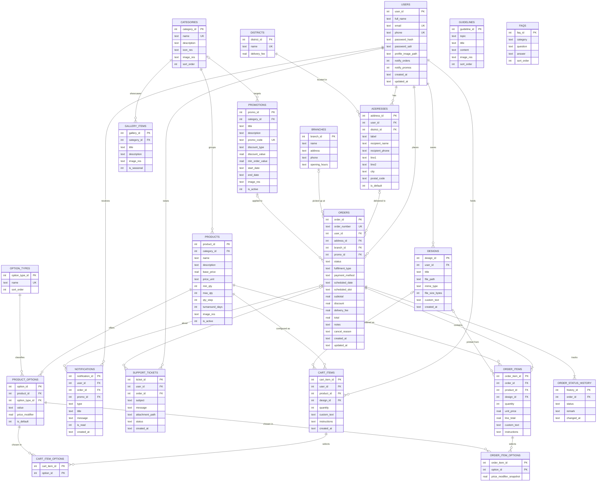

# 03 – Database Design (SQLite)

Database file: `printxpress.db`. Version 1. Managed by the `DatabaseHelper` singleton
(`SQLiteOpenHelper`). `PRAGMA foreign_keys = ON` is set in `onConfigure()`.

## 1. Entity list

| # | Table | Purpose |
|---|-------|---------|
| 1 | `users` | Customer accounts |
| 2 | `districts` | 25 Sri Lankan districts + delivery fee (lookup) |
| 3 | `addresses` | Customer delivery addresses |
| 4 | `branches` | Pickup branches |
| 5 | `categories` | Product categories |
| 6 | `products` | Printable products |
| 7 | `option_types` | Spec dimensions (Size, Paper Type, Material, Finish, Sides, Colour) |
| 8 | `product_options` | Allowed option values per product + price modifier |
| 9 | `designs` | Uploaded artwork / custom text saved by a user |
| 10 | `cart_items` | Configured items not yet ordered |
| 11 | `cart_item_options` | Selected options per cart item (M:N) |
| 12 | `promotions` | Seasonal offers / promo codes |
| 13 | `orders` | Order header |
| 14 | `order_items` | Lines of an order |
| 15 | `order_item_options` | Selected options per order line (M:N) |
| 16 | `order_status_history` | Status audit trail (timeline) |
| 17 | `notifications` | In-app notification centre |
| 18 | `gallery_items` | Sample design gallery |
| 19 | `guidelines` | Print file guidelines |
| 20 | `faqs` | Frequently asked questions |
| 21 | `support_tickets` | Customer support requests |

## 2. ER diagram (Mermaid – paste into mermaid.live or draw.io for the report)



## 3. Normalisation walkthrough (write this up for Task B)

**UNF – one "order form" record:**
`OrderNo, CustomerName, Email, Phone, Address, District, DeliveryFee, {Product, Category, Qty, Size,
Paper, Finish, UnitPrice, FileName}, PromoCode, Discount, Status, StatusDates…`

**1NF:** remove repeating groups. Order lines go into `order_items`, and the selected specs (repeating per line)
go into `order_item_options`. Status changes go into `order_status_history`. Every attribute is atomic
(the address is split into line1/line2/city/postal_code).

**2NF:** remove partial dependencies on composite keys. In `order_item_options(order_item_id, option_id)`,
the option *value* and *type* depend only on `option_id`, so they move to `product_options` and `option_types`.
Product name and category depend only on `product_id`, so they move to `products` and `categories`.

**3NF:** remove transitive dependencies. `DeliveryFee` depends on `District`, not on the address, so it
goes into `districts`. Customer name and email depend on `user_id`, not the order, so they go into `users`.
The promo discount rule depends on `promo_id`, so it goes into `promotions`.

**Deliberate, documented snapshots (not a 3NF violation in intent):** `order_items.unit_price`,
`line_total`, `order_item_options.price_modifier_snapshot` and `orders.delivery_fee/discount/total`
record the **price at the time of purchase**. Catalogue prices may change later, and historic
invoices must not. Justify this as a standard historical-accuracy decision.

## 4. DDL (goes into `DbContract` / `DatabaseHelper.onCreate`)

```sql
CREATE TABLE users (
  user_id            INTEGER PRIMARY KEY AUTOINCREMENT,
  full_name          TEXT    NOT NULL,
  email              TEXT    UNIQUE COLLATE NOCASE,
  phone              TEXT    UNIQUE,
  password_hash      TEXT    NOT NULL,
  password_salt      TEXT    NOT NULL,
  profile_image_path TEXT,
  notify_orders      INTEGER NOT NULL DEFAULT 1,
  notify_promos      INTEGER NOT NULL DEFAULT 1,
  created_at         TEXT    NOT NULL DEFAULT (datetime('now','localtime')),
  updated_at         TEXT    NOT NULL DEFAULT (datetime('now','localtime')),
  CHECK (email IS NOT NULL OR phone IS NOT NULL)
);

CREATE TABLE districts (
  district_id  INTEGER PRIMARY KEY AUTOINCREMENT,
  name         TEXT NOT NULL UNIQUE,
  delivery_fee REAL NOT NULL CHECK (delivery_fee >= 0)
);

CREATE TABLE addresses (
  address_id      INTEGER PRIMARY KEY AUTOINCREMENT,
  user_id         INTEGER NOT NULL REFERENCES users(user_id) ON DELETE CASCADE,
  district_id     INTEGER NOT NULL REFERENCES districts(district_id),
  label           TEXT    NOT NULL,
  recipient_name  TEXT    NOT NULL,
  recipient_phone TEXT    NOT NULL,
  line1           TEXT    NOT NULL,
  line2           TEXT,
  city            TEXT    NOT NULL,
  postal_code     TEXT    NOT NULL CHECK (length(postal_code) = 5),
  is_default      INTEGER NOT NULL DEFAULT 0 CHECK (is_default IN (0,1))
);

CREATE TABLE branches (
  branch_id     INTEGER PRIMARY KEY AUTOINCREMENT,
  name          TEXT NOT NULL,
  address       TEXT NOT NULL,
  phone         TEXT NOT NULL,
  opening_hours TEXT NOT NULL
);

CREATE TABLE categories (
  category_id INTEGER PRIMARY KEY AUTOINCREMENT,
  name        TEXT NOT NULL UNIQUE,
  description TEXT,
  icon_res    TEXT NOT NULL,
  image_res   TEXT NOT NULL,
  sort_order  INTEGER NOT NULL DEFAULT 0
);

CREATE TABLE products (
  product_id      INTEGER PRIMARY KEY AUTOINCREMENT,
  category_id     INTEGER NOT NULL REFERENCES categories(category_id),
  name            TEXT    NOT NULL,
  description     TEXT    NOT NULL,
  base_price      REAL    NOT NULL CHECK (base_price > 0),
  price_unit      TEXT    NOT NULL,
  min_qty         INTEGER NOT NULL CHECK (min_qty > 0),
  max_qty         INTEGER NOT NULL,
  qty_step        INTEGER NOT NULL DEFAULT 1,
  turnaround_days INTEGER NOT NULL DEFAULT 2,
  image_res       TEXT    NOT NULL,
  is_active       INTEGER NOT NULL DEFAULT 1,
  CHECK (max_qty >= min_qty)
);

CREATE TABLE option_types (
  option_type_id INTEGER PRIMARY KEY AUTOINCREMENT,
  name           TEXT NOT NULL UNIQUE,
  sort_order     INTEGER NOT NULL DEFAULT 0
);

CREATE TABLE product_options (
  option_id      INTEGER PRIMARY KEY AUTOINCREMENT,
  product_id     INTEGER NOT NULL REFERENCES products(product_id) ON DELETE CASCADE,
  option_type_id INTEGER NOT NULL REFERENCES option_types(option_type_id),
  value          TEXT    NOT NULL,
  price_modifier REAL    NOT NULL DEFAULT 0,
  is_default     INTEGER NOT NULL DEFAULT 0,
  UNIQUE (product_id, option_type_id, value)
);

CREATE TABLE designs (
  design_id       INTEGER PRIMARY KEY AUTOINCREMENT,
  user_id         INTEGER NOT NULL REFERENCES users(user_id) ON DELETE CASCADE,
  title           TEXT    NOT NULL,
  file_path       TEXT,
  mime_type       TEXT,
  file_size_bytes INTEGER,
  custom_text     TEXT,
  created_at      TEXT NOT NULL DEFAULT (datetime('now','localtime')),
  CHECK (file_path IS NOT NULL OR custom_text IS NOT NULL)
);

CREATE TABLE cart_items (
  cart_item_id INTEGER PRIMARY KEY AUTOINCREMENT,
  user_id      INTEGER NOT NULL REFERENCES users(user_id) ON DELETE CASCADE,
  product_id   INTEGER NOT NULL REFERENCES products(product_id),
  design_id    INTEGER REFERENCES designs(design_id) ON DELETE SET NULL,
  quantity     INTEGER NOT NULL CHECK (quantity > 0),
  custom_text  TEXT,
  instructions TEXT,
  created_at   TEXT NOT NULL DEFAULT (datetime('now','localtime'))
);

CREATE TABLE cart_item_options (
  cart_item_id INTEGER NOT NULL REFERENCES cart_items(cart_item_id) ON DELETE CASCADE,
  option_id    INTEGER NOT NULL REFERENCES product_options(option_id),
  PRIMARY KEY (cart_item_id, option_id)
);

CREATE TABLE promotions (
  promo_id        INTEGER PRIMARY KEY AUTOINCREMENT,
  category_id     INTEGER REFERENCES categories(category_id),
  title           TEXT NOT NULL,
  description     TEXT NOT NULL,
  promo_code      TEXT NOT NULL UNIQUE,
  discount_type   TEXT NOT NULL CHECK (discount_type IN ('PERCENT','FIXED')),
  discount_value  REAL NOT NULL CHECK (discount_value > 0),
  min_order_value REAL NOT NULL DEFAULT 0,
  start_date      TEXT NOT NULL,
  end_date        TEXT NOT NULL,
  image_res       TEXT NOT NULL,
  is_active       INTEGER NOT NULL DEFAULT 1,
  CHECK (end_date >= start_date)
);

CREATE TABLE orders (
  order_id        INTEGER PRIMARY KEY AUTOINCREMENT,
  order_number    TEXT NOT NULL UNIQUE,
  user_id         INTEGER NOT NULL REFERENCES users(user_id) ON DELETE CASCADE,
  address_id      INTEGER REFERENCES addresses(address_id) ON DELETE SET NULL,
  branch_id       INTEGER REFERENCES branches(branch_id),
  promo_id        INTEGER REFERENCES promotions(promo_id),
  status          TEXT NOT NULL DEFAULT 'PENDING' CHECK (status IN
                  ('PENDING','CONFIRMED','PROCESSING','PRINTING','READY_FOR_PICKUP',
                   'OUT_FOR_DELIVERY','COMPLETED','CANCELLED')),
  fulfilment_type TEXT NOT NULL CHECK (fulfilment_type IN ('PICKUP','DELIVERY')),
  payment_method  TEXT NOT NULL CHECK (payment_method IN ('PAY_AT_PICKUP','CASH_ON_DELIVERY')),
  scheduled_date  TEXT NOT NULL,
  scheduled_slot  TEXT NOT NULL,
  subtotal        REAL NOT NULL,
  discount        REAL NOT NULL DEFAULT 0,
  delivery_fee    REAL NOT NULL DEFAULT 0,
  total           REAL NOT NULL,
  notes           TEXT,
  cancel_reason   TEXT,
  created_at      TEXT NOT NULL DEFAULT (datetime('now','localtime')),
  updated_at      TEXT NOT NULL DEFAULT (datetime('now','localtime')),
  CHECK ((fulfilment_type = 'PICKUP' AND branch_id IS NOT NULL) OR
         (fulfilment_type = 'DELIVERY' AND address_id IS NOT NULL))
);

CREATE TABLE order_items (
  order_item_id INTEGER PRIMARY KEY AUTOINCREMENT,
  order_id      INTEGER NOT NULL REFERENCES orders(order_id) ON DELETE CASCADE,
  product_id    INTEGER NOT NULL REFERENCES products(product_id),
  design_id     INTEGER REFERENCES designs(design_id) ON DELETE SET NULL,
  quantity      INTEGER NOT NULL CHECK (quantity > 0),
  unit_price    REAL    NOT NULL,
  line_total    REAL    NOT NULL,
  custom_text   TEXT,
  instructions  TEXT
);

CREATE TABLE order_item_options (
  order_item_id           INTEGER NOT NULL REFERENCES order_items(order_item_id) ON DELETE CASCADE,
  option_id               INTEGER NOT NULL REFERENCES product_options(option_id),
  price_modifier_snapshot REAL    NOT NULL,
  PRIMARY KEY (order_item_id, option_id)
);

CREATE TABLE order_status_history (
  history_id INTEGER PRIMARY KEY AUTOINCREMENT,
  order_id   INTEGER NOT NULL REFERENCES orders(order_id) ON DELETE CASCADE,
  status     TEXT NOT NULL,
  remark     TEXT,
  changed_at TEXT NOT NULL DEFAULT (datetime('now','localtime'))
);

CREATE TABLE notifications (
  notification_id INTEGER PRIMARY KEY AUTOINCREMENT,
  user_id         INTEGER NOT NULL REFERENCES users(user_id) ON DELETE CASCADE,
  order_id        INTEGER REFERENCES orders(order_id) ON DELETE CASCADE,
  promo_id        INTEGER REFERENCES promotions(promo_id),
  type            TEXT NOT NULL CHECK (type IN ('ORDER','PROMO','SYSTEM')),
  title           TEXT NOT NULL,
  message         TEXT NOT NULL,
  is_read         INTEGER NOT NULL DEFAULT 0,
  created_at      TEXT NOT NULL DEFAULT (datetime('now','localtime'))
);

CREATE TABLE gallery_items (
  gallery_id  INTEGER PRIMARY KEY AUTOINCREMENT,
  category_id INTEGER NOT NULL REFERENCES categories(category_id),
  title       TEXT NOT NULL,
  description TEXT,
  image_res   TEXT NOT NULL,
  is_seasonal INTEGER NOT NULL DEFAULT 0
);

CREATE TABLE guidelines (
  guideline_id INTEGER PRIMARY KEY AUTOINCREMENT,
  topic        TEXT NOT NULL CHECK (topic IN ('FILE_FORMAT','RESOLUTION','COLOUR','BLEED','FONTS')),
  title        TEXT NOT NULL,
  content      TEXT NOT NULL,
  image_res    TEXT,
  sort_order   INTEGER NOT NULL DEFAULT 0
);

CREATE TABLE faqs (
  faq_id     INTEGER PRIMARY KEY AUTOINCREMENT,
  category   TEXT NOT NULL,
  question   TEXT NOT NULL,
  answer     TEXT NOT NULL,
  sort_order INTEGER NOT NULL DEFAULT 0
);

CREATE TABLE support_tickets (
  ticket_id       INTEGER PRIMARY KEY AUTOINCREMENT,
  user_id         INTEGER NOT NULL REFERENCES users(user_id) ON DELETE CASCADE,
  order_id        INTEGER REFERENCES orders(order_id) ON DELETE SET NULL,
  subject         TEXT NOT NULL,
  message         TEXT NOT NULL,
  attachment_path TEXT,
  status          TEXT NOT NULL DEFAULT 'OPEN' CHECK (status IN ('OPEN','IN_PROGRESS','RESOLVED')),
  created_at      TEXT NOT NULL DEFAULT (datetime('now','localtime'))
);

CREATE INDEX idx_products_category ON products(category_id);
CREATE INDEX idx_orders_user_status ON orders(user_id, status);
CREATE INDEX idx_order_items_order ON order_items(order_id);
CREATE INDEX idx_history_order ON order_status_history(order_id);
CREATE INDEX idx_notifications_user_read ON notifications(user_id, is_read);
CREATE INDEX idx_cart_user ON cart_items(user_id);
```

## 5. Seed data (`DatabaseSeeder`, runs in `onCreate` inside one transaction)

| Table | Seed |
|-------|------|
| districts | All 25 districts. Colombo Rs 300, Gampaha/Kalutara Rs 400, others Rs 600 |
| branches | PrintXpress Colombo 03, Kandy, Galle |
| categories | Business Cards, Flyers, Posters, Banners, Stickers, Mugs, T-Shirts |
| option_types | Size, Paper Type, Material, Finish, Sides, Colour |
| products | ~2–3 per category (e.g. Standard Business Card Rs 1,500 / 100, min 100, step 50, max 5000, 2 days; Premium Matte Card; A5 Flyer; A4 Flyer; A3/A2 Poster; PVC/Flex Banner; Vinyl Die-cut Sticker; Ceramic Mug 11oz; Cotton Crew T-Shirt) |
| product_options | Size (3.5"x2", A5, A4, A3, 2x4 ft, 3x6 ft, S/M/L/XL), Paper (300gsm Art, 350gsm Matte, 130gsm Gloss), Material (Flex, PVC, Vinyl, Ceramic, Cotton), Finish (Matte, Gloss, Spot UV), Sides (Single, Double +40%), Colour |
| promotions | `AVURUDU26` 15% (April), `VESAK26` Rs 500 off lanterns/posters, `BULK500` 10% ≥ Rs 20,000, `DEEPAVALI26` 12% ≥ Rs 3,000 (1 Oct – 15 Nov), `XMAS26` 20% cards (Dec), `WELCOME10` 10% first order |

**Pricing convention (as built):** `products.base_price` is the price of **one unit** (Standard Business
Card Rs 15.00 per card, shown as "Rs 1,500 / 100"), and `product_options.price_modifier` is a **percentage**
added to the unit price (Double sided = `40`). The line price is base × quantity × (1 + Σ modifiers / 100),
then the BR-4 bulk discount (10% from 500, 15% from 1000) applies per line.
| guidelines | File formats (PDF/X-1a, PNG, JPG), 300 DPI, CMYK vs RGB, 3 mm bleed + 5 mm safe zone, outline fonts |
| faqs | ~12 Q&A (turnaround, delivery areas, file formats, colour differences, cancellation policy, payment) |
| gallery_items | ~20 samples across categories, some marked seasonal |

## 6. Key queries (DAO methods)

| DAO method | SQL sketch |
|------------|-----------|
| `UserDao.findByIdentifier(String)` | `SELECT * FROM users WHERE email = ? OR phone = ? LIMIT 1` |
| `ProductDao.filter(catId, optionIds, sort)` | `SELECT DISTINCT p.* FROM products p JOIN product_options po ON po.product_id = p.product_id WHERE p.category_id = ? AND po.option_id IN (…) ORDER BY p.base_price ASC` |
| `OrderDao.getActive(userId)` | `SELECT * FROM orders WHERE user_id = ? AND status NOT IN ('COMPLETED','CANCELLED') ORDER BY created_at DESC` |
| `OrderDao.insertOrderWithItems(Order)` | Transaction: insert order → items → item options → history → delete cart |
| `OrderDao.updateStatus(id, status, remark)` | Transaction: `UPDATE orders SET status=?, updated_at=…` + insert history |
| `NotificationDao.unreadCount(userId)` | `SELECT COUNT(*) FROM notifications WHERE user_id = ? AND is_read = 0` |
| `PromotionDao.findValid(code, today)` | `SELECT * FROM promotions WHERE promo_code = ? AND is_active = 1 AND ? BETWEEN start_date AND end_date` |

## 7. Upgrade strategy

`onUpgrade(db, old, new)` runs step-wise migrations (`if (old < 2) migrateTo2(db)`), so user data is
never dropped. Mention this in the technical documentation.
