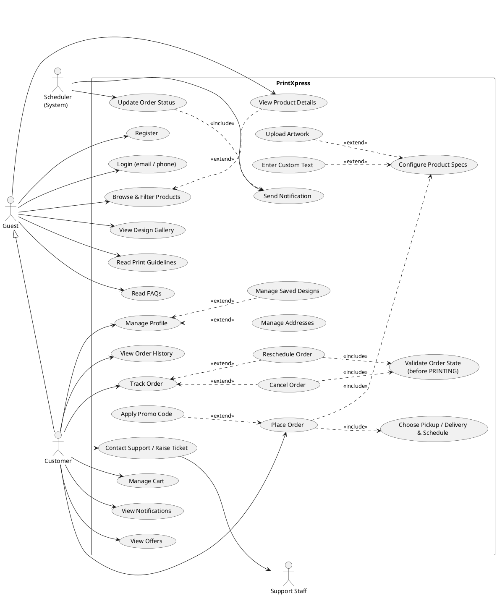
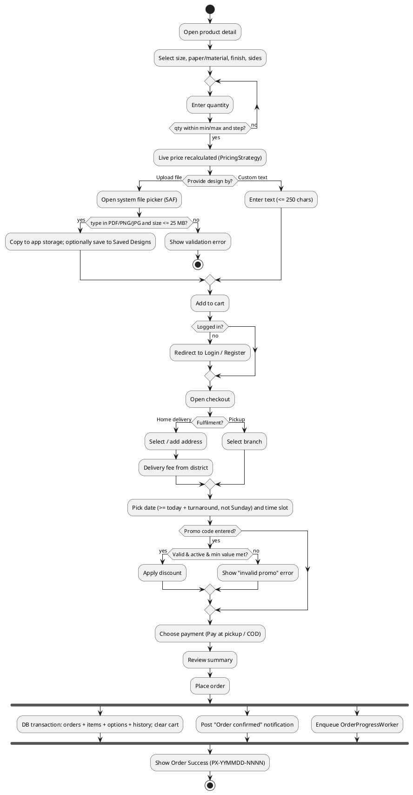
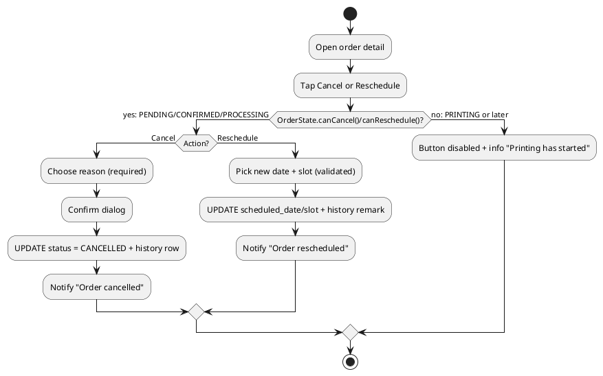
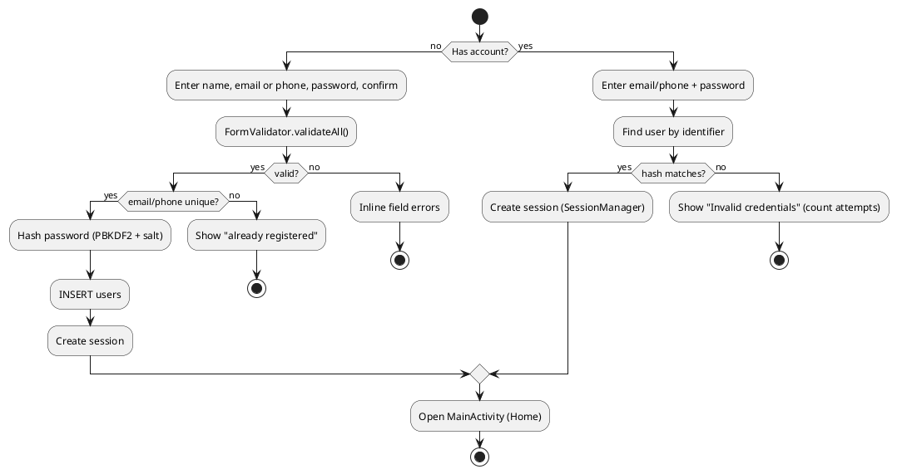
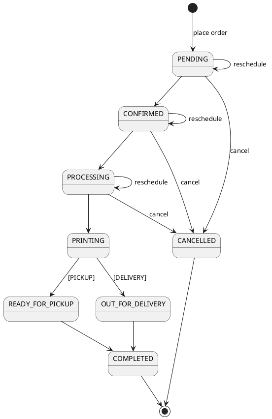
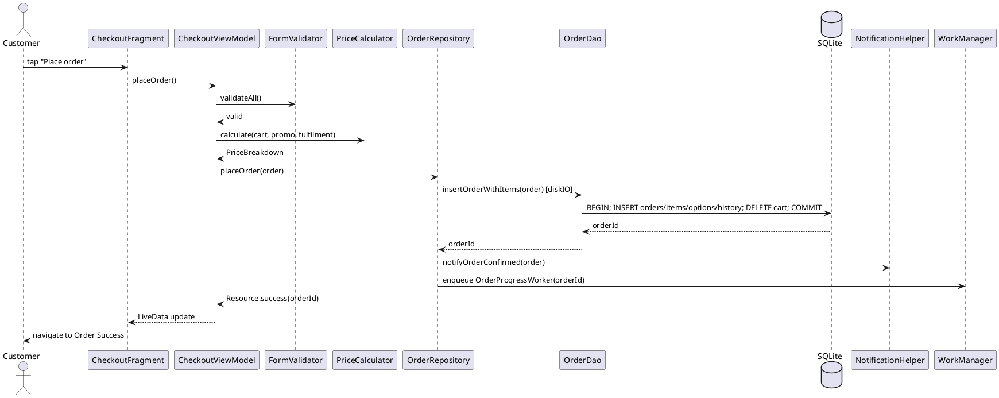

# 04 – UML Diagrams (Task B)

All diagrams are in **PlantUML**. Render them at https://www.plantuml.com/plantuml, in the VS Code / IntelliJ
PlantUML plugin, or redraw them in draw.io / StarUML for the report. Under each diagram, add one
paragraph on the **design decisions** (the rubric rewards justification).

---

## 1. Use case diagram

**Design decision notes:** Customer specialises Guest (inheritance of actors), so browsing is open
without an account and there is less friction. Cancel and Reschedule `<<include>>` a state check because BR-7
applies to both. The Scheduler is modelled as a system actor because there is no admin app.

---

## 2. Class diagram (domain + key architecture)

```plantuml
@startuml
skinparam classAttributeIconSize 0
package model {
  class User {
    -userId:long
    -fullName:String
    -email:String
    -phone:String
    -passwordHash:String
    -passwordSalt:String
    +getters/setters()
  }
  class Address {
    -addressId:long
    -userId:long
    -districtId:long
    -label:String
    -line1:String
    -city:String
    -postalCode:String
    -isDefault:boolean
  }
  class District {
    -districtId:long
    -name:String
    -deliveryFee:Money
  }
  class Branch {
    -branchId:long
    -name:String
    -address:String
  }
  class Category {
    -categoryId:long
    -name:String
    -iconRes:String
  }
  class Product {
    -productId:long
    -categoryId:long
    -name:String
    -basePrice:Money
    -minQty:int
    -maxQty:int
    -qtyStep:int
    -turnaroundDays:int
  }
  class OptionType {
    -optionTypeId:long
    -name:String
  }
  class ProductOption {
    -optionId:long
    -value:String
    -priceModifier:Money
  }
  class Design {
    -designId:long
    -title:String
    -filePath:String
    -mimeType:String
    -customText:String
  }
  class CartItem {
    -cartItemId:long
    -quantity:int
    -options:List<ProductOption>
    +Builder
  }
  class Order {
    -orderId:long
    -orderNumber:String
    -fulfilmentType:FulfilmentType
    -paymentMethod:PaymentMethod
    -scheduledDate:LocalDate
    -slot:String
    -breakdown:PriceBreakdown
    -state:OrderState
    +cancel(reason)
    +reschedule(date,slot)
    +advance()
    +Builder
  }
  class OrderItem {
    -orderItemId:long
    -quantity:int
    -unitPrice:Money
    -lineTotal:Money
  }
  class OrderStatusHistory {
    -status:OrderStatus
    -remark:String
    -changedAt:LocalDateTime
  }
  class Promotion {
    -promoCode:String
    -discountType:DiscountType
    -discountValue:double
    -startDate:LocalDate
    -endDate:LocalDate
    +isValidOn(date):boolean
  }
  class AppNotification {
    -type:NotificationType
    -title:String
    -message:String
    -isRead:boolean
  }
  class Money <<value object>> {
    -amount:BigDecimal
    +plus(Money)
    +times(int)
    +percent(double)
  }
  enum OrderStatus {
    PENDING
    CONFIRMED
    PROCESSING
    PRINTING
    READY_FOR_PICKUP
    OUT_FOR_DELIVERY
    COMPLETED
    CANCELLED
  }
  enum FulfilmentType {
    PICKUP
    DELIVERY
  }
}

User "1" -- "0..*" Address
Address "*" -- "1" District
User "1" -- "0..*" Order
User "1" -- "0..*" Design
User "1" -- "0..*" CartItem
Category "1" -- "0..*" Product
Product "1" -- "0..*" ProductOption
OptionType "1" -- "0..*" ProductOption
Order "1" *-- "1..*" OrderItem
Order "1" *-- "1..*" OrderStatusHistory
OrderItem "*" -- "1" Product
OrderItem "*" -- "0..*" ProductOption
OrderItem "*" -- "0..1" Design
Order "*" -- "0..1" Promotion
Order "*" -- "0..1" Address
Order "*" -- "0..1" Branch
User "1" -- "0..*" AppNotification

package domain.order {
  interface OrderState {
    +getStatus():OrderStatus
    +canCancel():boolean
    +canReschedule():boolean
    +next(FulfilmentType):OrderState
  }
  abstract class AbstractOrderState
  class PendingState
  class ConfirmedState
  class ProcessingState
  class PrintingState
  class ReadyForPickupState
  class OutForDeliveryState
  class CompletedState
  class CancelledState
  class OrderStateFactory {
    +{static} from(OrderStatus):OrderState
  }
}
OrderState <|.. AbstractOrderState
AbstractOrderState <|-- PendingState
AbstractOrderState <|-- ConfirmedState
AbstractOrderState <|-- ProcessingState
AbstractOrderState <|-- PrintingState
AbstractOrderState <|-- ReadyForPickupState
AbstractOrderState <|-- OutForDeliveryState
AbstractOrderState <|-- CompletedState
AbstractOrderState <|-- CancelledState
Order o-- OrderState

package domain.pricing {
  interface PricingStrategy {
    +apply(PricingContext, Money):Money
  }
  class OptionModifierPricing
  class BulkDiscountPricing
  class PromoCodePricing
  class CompositePricingStrategy {
    -strategies:List<PricingStrategy>
  }
  class PriceCalculator {
    +calculate(List<CartItem>, Promotion, FulfilmentStrategy):PriceBreakdown
  }
}
PricingStrategy <|.. OptionModifierPricing
PricingStrategy <|.. BulkDiscountPricing
PricingStrategy <|.. PromoCodePricing
PricingStrategy <|.. CompositePricingStrategy
CompositePricingStrategy o-- PricingStrategy
PriceCalculator --> CompositePricingStrategy

package domain.fulfilment {
  interface FulfilmentStrategy {
    +deliveryFee():Money
    +earliestDate(int):LocalDate
  }
  class PickupStrategy
  class HomeDeliveryStrategy
}
FulfilmentStrategy <|.. PickupStrategy
FulfilmentStrategy <|.. HomeDeliveryStrategy
PriceCalculator --> FulfilmentStrategy

package core.validation {
  interface ValidationRule {
    +validate(String):ValidationResult
  }
  class FormValidator {
    +addField(PxTextInput, ValidationRule...)
    +validateAll():boolean
  }
  class EmailRule
  class SriLankanPhoneRule
  class PasswordStrengthRule
  class RangeRule
}
ValidationRule <|.. EmailRule
ValidationRule <|.. SriLankanPhoneRule
ValidationRule <|.. PasswordStrengthRule
ValidationRule <|.. RangeRule
FormValidator o-- ValidationRule

package data {
  class DatabaseHelper <<Singleton>> {
    -{static} instance
    +{static} getInstance(Context)
  }
  abstract class "BaseDao<T>" as BaseDao {
    #db:DatabaseHelper
    #{abstract} map(Cursor):T
    #{abstract} toValues(T):ContentValues
  }
  class OrderDao
  class OrderRepository {
    +placeOrder(Order):LiveData<Resource<Long>>
    +cancelOrder(long,String)
    +reschedule(long,LocalDate,String)
    +getActiveOrders(long)
  }
}
BaseDao <|-- OrderDao
OrderDao --> DatabaseHelper
OrderRepository --> OrderDao

package ui {
  abstract class "BaseViewModel" as BVM
  class OrderDetailViewModel
  class OrderDetailFragment
  class ViewModelFactory <<Factory>>
}
BVM <|-- OrderDetailViewModel
OrderDetailViewModel --> OrderRepository
OrderDetailFragment ..> OrderDetailViewModel : observes LiveData
ViewModelFactory ..> OrderDetailViewModel : creates
@enduml
```

**Design decision notes:** Composition (`*--`) between Order and OrderItem/History, because lines have no
life without the order (this matches `ON DELETE CASCADE`). The State pattern encapsulates BR-7. The Strategy
+ Composite patterns allow new discount types without changing existing code (Open/Closed principle). `Money`
uses `BigDecimal` to avoid floating-point rounding errors on currency.

---

## 3. Activity diagram – Place an order

## 4. Activity diagram – Cancel / reschedule

## 5. Activity diagram – Register / Login

## 6. State machine diagram – Order status

## 7. Sequence diagram – Place order (for the technical documentation)

