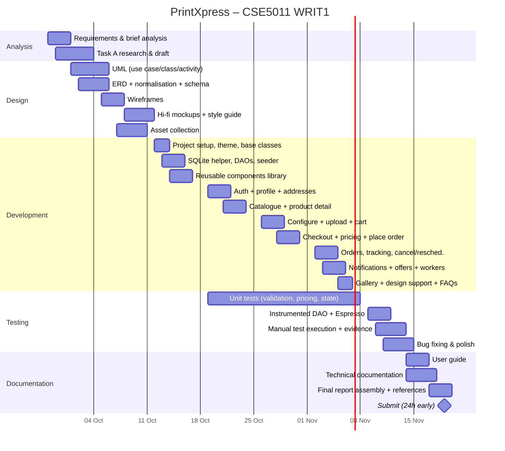

# 08 – Project Plan

**Deadline:** set on Moodle. This plan assumes **8 weeks** from Mon 28 Sep 2026 and submission by
**Fri 20 Nov 2026 (2.00 pm)**. If the Moodle date is different, shift the dates and keep the phase lengths
in proportion. Submit at least **24 h early** (the brief strongly advises this).

Methodology: **Agile-lite, 1-week sprints**, each ending with a runnable build and updated `TASK.md`.
Work in priority order: MUST → SHOULD → COULD (docs/01).

## 1. Phases and milestones

| Phase | Weeks | Dates (2026) | Output | Assessment task | Milestone |
|-------|-------|--------------|--------|-----------------|-----------|
| P0 Analysis and research | 1 | 28 Sep – 02 Oct | Requirements, Task A draft, tool comparison | A | M0: requirements signed off |
| P1 System and DB design | 1–2 | 01 Oct – 09 Oct | UML, ERD, normalisation, schema | B | M1: design frozen |
| P2 UI/UX design | 2 | 05 Oct – 12 Oct | Style guide, wireframes → hi-fi mockups (Figma), assets gathered | C | M2: mockups approved |
| P3 Foundation build | 3 | 12 Oct – 16 Oct | Project set-up, theme, base classes, DB + DAOs + seeder, components library | D | M3: DB and components ready |
| P4 Feature sprint 1 | 4 | 19 Oct – 23 Oct | Auth, profile, addresses, catalogue, product detail | D | M4: browse + auth demo |
| P5 Feature sprint 2 | 5 | 26 Oct – 30 Oct | Configure, upload/text, cart, checkout, pricing, place order | D | M5: end-to-end order |
| P6 Feature sprint 3 | 6 | 02 Nov – 06 Nov | Orders/tracking, reschedule/cancel, notifications, offers, gallery, support | D | M6: feature complete |
| P7 Testing and polish | 7 | 09 Nov – 13 Nov | Unit/instrumented/manual tests, bug fixes, accessibility, dark mode | E | M7: test report done |
| P8 Documentation and submission | 8 | 14 Nov – 20 Nov | User and technical docs, final report PDF, references, video (optional) | F | M8: submitted |

## 2. Gantt chart



## 3. Work breakdown structure

```
PrintXpress
├── 1 Analysis        1.1 brief analysis  1.2 requirements  1.3 tech comparison (Task A)
├── 2 Design          2.1 use case  2.2 class  2.3 activity  2.4 ERD + 3NF  2.5 UI mockups  2.6 assets
├── 3 Development     3.1 setup  3.2 data layer  3.3 domain layer  3.4 components  3.5 features (8 modules)
├── 4 Testing         4.1 test plan  4.2 unit  4.3 instrumented  4.4 manual + evidence
└── 5 Documentation   5.1 user guide  5.2 technical doc  5.3 report + references
```

## 4. Report word budget (3000 words, appendices excluded)

| Section | Words |
|---------|-------|
| Introduction | 150 |
| Task A – critical comparison | 1000 |
| Task B – design explanations | 500 |
| Task C – UI design rationale | 350 |
| Task D – implementation highlights (validation, DB) | 400 |
| Task E – test approach summary (full tables in appendix) | 250 |
| Task F – documentation summary (full guides in appendix) | 200 |
| Conclusion | 150 |

## 5. Risk register

| # | Risk | Likelihood | Impact | Mitigation |
|---|------|-----------|--------|-----------|
| R1 | Scope too large for the deadline | M | H | MoSCoW. Finish all MUST items before any SHOULD |
| R2 | SQLite schema changes mid-build | M | M | Freeze the design at M1. Use versioned `onUpgrade` migrations |
| R3 | File upload/permission issues across Android versions | M | M | Use the SAF picker (no storage permission). Test on API 24 and API 35/36 emulators |
| R4 | Notification permission denied (Android 13+) | M | L | Rationale dialog. The in-app notification centre still works |
| R5 | Main-thread DB causing ANR | L | H | `AppExecutors.diskIO()` rule; enable StrictMode in debug |
| R6 | Plagiarism/unreferenced images | L | H | Keep an asset licence log (docs/07). Harvard references |
| R7 | Laptop/data loss | L | H | Git with a private GitHub repo, pushed daily |
| R8 | Emulator performance on a low-spec PC | M | M | Test on a physical device over USB/Wi-Fi debugging |

## 6. Definition of Done (per feature)

- Functional requirements met and all validation rules applied.
- Loading, empty and error states implemented.
- Javadoc on every class and public method, and no `//` comments.
- Works in light and dark mode and in portrait orientation. No hard-coded strings or colours.
- Related test cases in docs/09 executed, with a screenshot saved to `evidence/`.
- `TASK.md` item ticked.
