# 13 – PrintXpress User Guide (Task F – Part A)

Version 1.0 · Android 7.0 and later · Screenshots: Pixel 7 emulator, light theme (`docs/screenshots/`).

---

## 1. Introduction

PrintXpress is the customer app of a Sri Lankan digital printing shop. It lets you order business cards,
flyers, posters, banners, stickers, mugs and t-shirts from your phone:

- browse products;
- choose the specification;
- upload artwork or type your text;
- pick it up at a branch or have it delivered.

You then follow the order through printing and receive a notification at every step.

## 2. System requirements

| Item | Requirement |
|------|-------------|
| Android version | 7.0 (API 24) or later; tested on Android 16 (API 36) |
| Free space | About 50 MB, plus space for the artwork files you upload |
| Permissions | Notifications (optional, asked once on Android 13+). No storage, camera or location permission is used. |
| Network | Not required – all data is stored on the device (see §13) |

## 3. Installation

**From the APK:**
1. Copy `app-debug.apk` to the phone.
2. Open it and allow **Install unknown apps** for your file manager when Android asks.
3. Tap **Install**.

**From Android Studio:**
1. Open the project.
2. Select a device or emulator.
3. Press **Run ▶**.

## 4. Getting started

| | |
|---|---|
|  | **Onboarding.** Three short pages explain the app. Tap **Next**, or **Skip** to go straight to sign-in. |
| 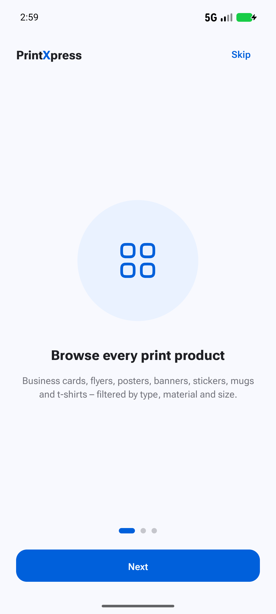 | **Sign in** with your email *or* mobile number and password. **Continue as guest** lets you browse; you are asked to sign in when you add to cart. **Forgot password?** resets it after you confirm the email *and* mobile number of the account. |
| 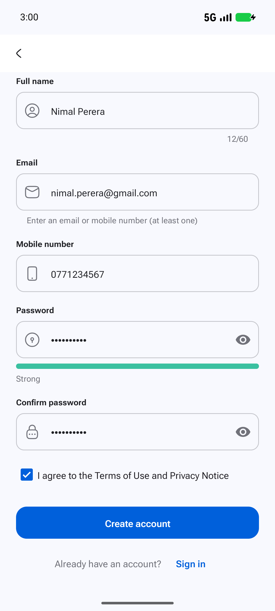 | **Create account.** Your full name is required, plus an email or a Sri Lankan mobile number (`07XXXXXXXX`). The password needs 8+ characters with upper and lower case, a digit and a symbol – the meter shows its strength. Accept the terms and tap **Create account**. |
| 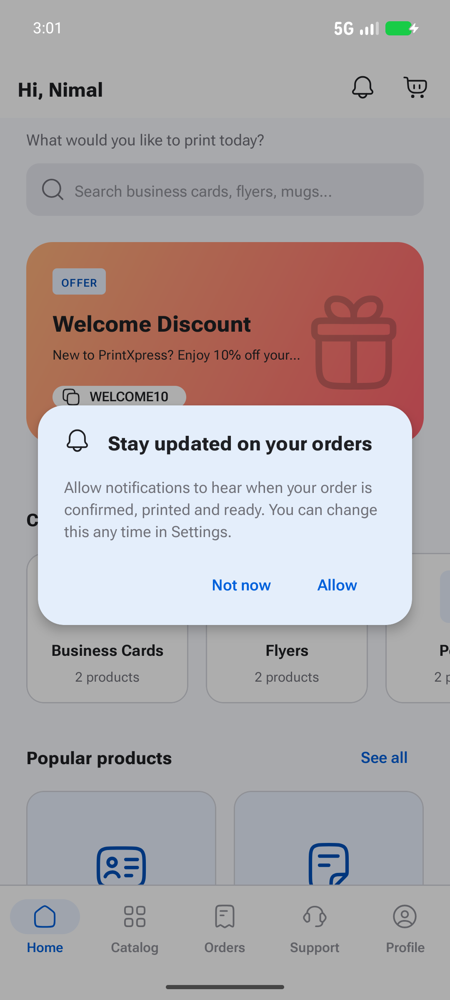 | **Notifications.** On Android 13+ the app explains why it wants to notify you, then Android asks. Choosing *Don't allow* is fine – every update is still listed in the in-app notification centre. |

## 5. Browsing products

| | |
|---|---|
| 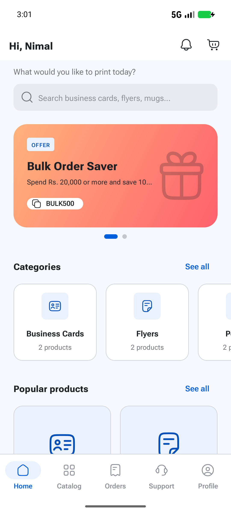 | **Home** shows current offers (tap the code chip to copy it), categories, popular products, design inspiration and your active order. The bell and cart icons show unread and item counts. |
| 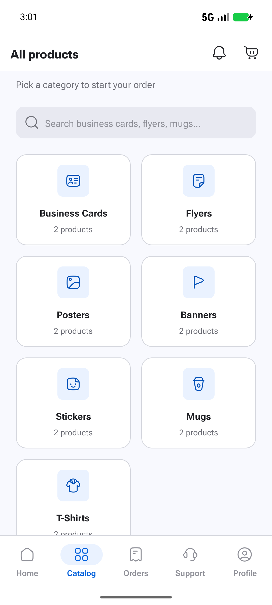 | **Catalog** lists every category. Use the search bar on Home or on a product list to search by name. |
| 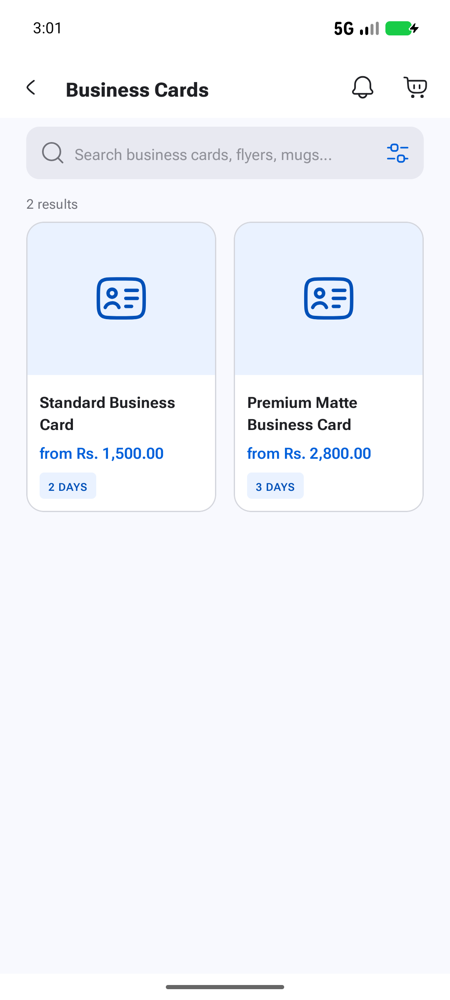 | **Product list.** Tap the filter icon to filter by type, material or size and to sort by price or name. |
| 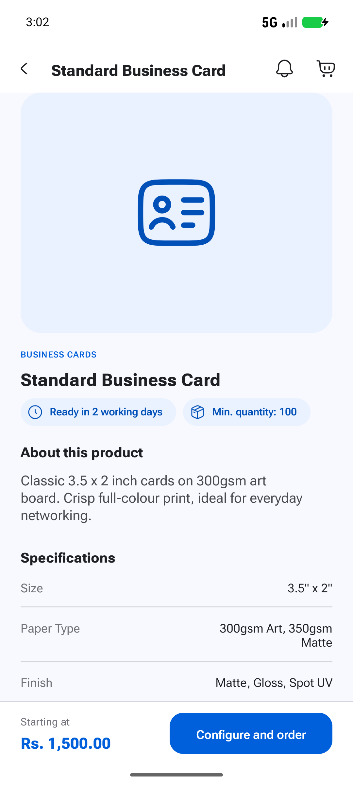 | **Product detail** shows the description, specifications, turnaround, starting price and the bulk-discount guide. Tap **Configure and order**. |

## 6. Placing an order

1. **Choose the specification** (screenshot 09).
   - Pick size, paper, finish and sides; each option shows its price effect, e.g. *Double sided +40%*.
   - Enter the quantity. The allowed range and step are shown, e.g. 100–5000 in steps of 50.
   - The live price includes bulk discounts: 10% from 500 units and 15% from 1000.
2. **Add your design** (screenshots 10–11).
   - *Upload file:* choose a PDF, PNG or JPG of up to 25 MB. It is saved to **Saved designs** for reuse.
   - *Type text:* enter up to 250 characters, e.g. your name and phone for a business card.
   - Optionally add instructions for the designers (up to 200 characters).
3. **Add to cart** (screenshot 12).
   - Change the quantity with the stepper, edit or remove a line, and see the price breakdown.
   - Tap **Checkout**.
4. **Pickup or delivery** (screenshot 13).
   - *Pick up at a branch* is free, and you pay when you collect.
   - *Home delivery* needs an address. The fee depends on the district, you pay cash on delivery, and it adds one day.
5. **Date and time slot.**
   - The earliest date respects the product's turnaround.
   - Sundays and fixed public holidays show as *Closed*.
   - Choose 09:00–12:00, 12:00–15:00 or 15:00–18:00, then tap **Review order**.
6. **Promo code and payment** (screenshot 14).
   - Enter a code such as `WELCOME10` (first order) and tap **Apply**; a specific message explains an invalid, expired or below-minimum code.
   - The payment method follows your choice: Pay at pickup or Cash on delivery.
   - Add notes if needed.
7. **Place order** (screenshot 15). You get an order number such as `PX-260922-0001` and a confirmation notification.

| 09 Configure | 11 Design text | 12 Cart | 13 Checkout | 14 Review | 15 Placed |
|---|---|---|---|---|---|
| 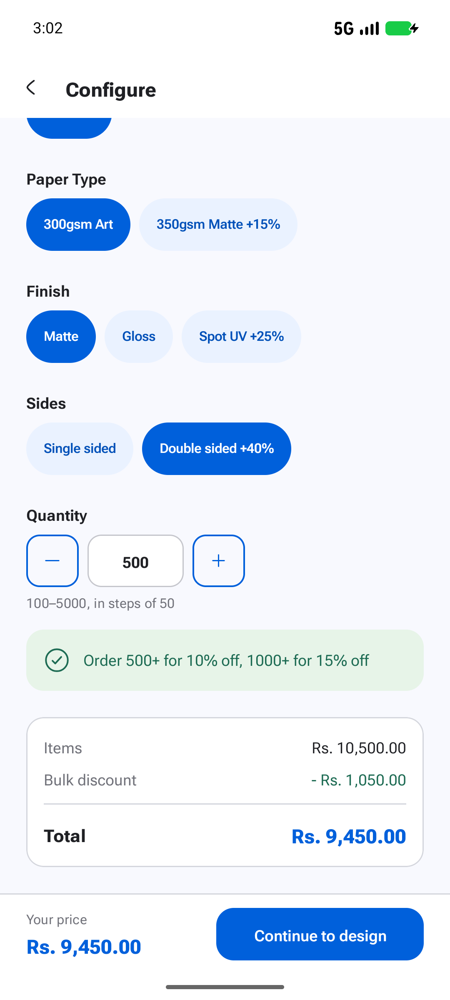 | 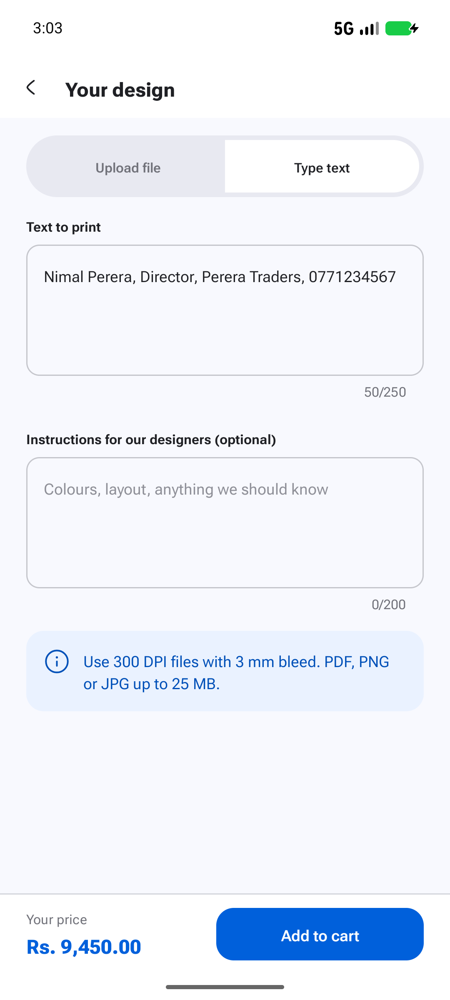 | 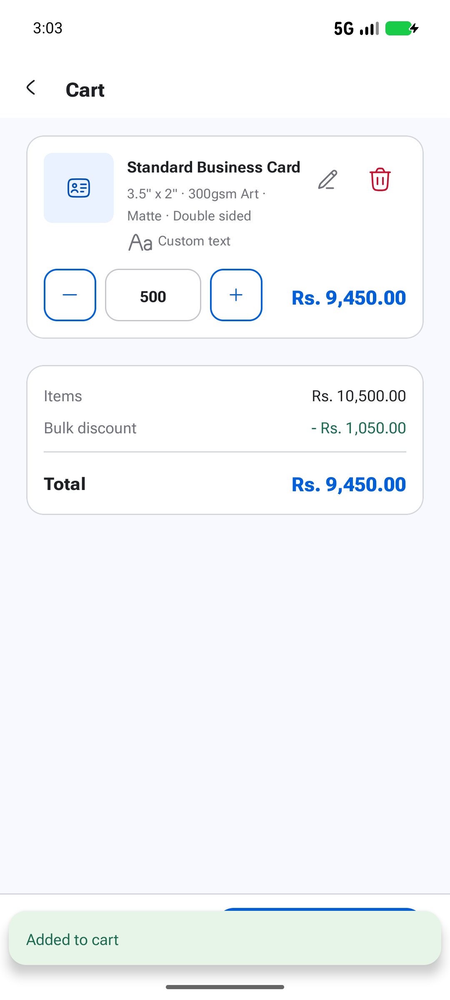 | 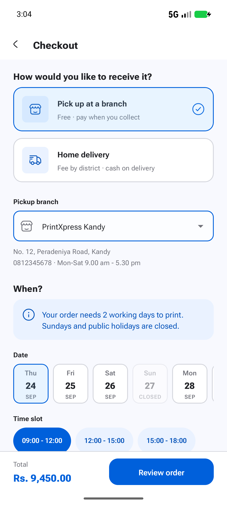 | 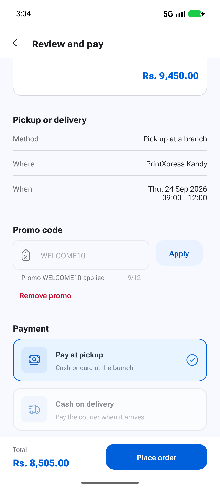 | 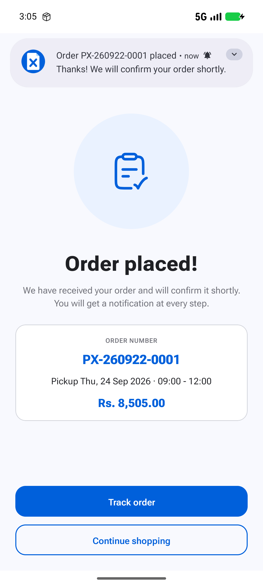 |

## 7. File preparation tips

- **Formats:** PDF (preferred), PNG or JPG, up to 25 MB.
- **Resolution:** 300 DPI at the printed size.
- **Colour:** CMYK. Bright RGB blues and greens print slightly duller.
- **Bleed:** extend backgrounds 3 mm past the trim line. Keep text 5 mm inside it (the safe zone).
  **Support › Print guidelines › Bleed and safe zone** shows a to-scale template you can share.
- **Fonts:** embed the fonts or convert them to outlines, and use at least 6 pt.

## 8. Managing orders

| | |
|---|---|
| 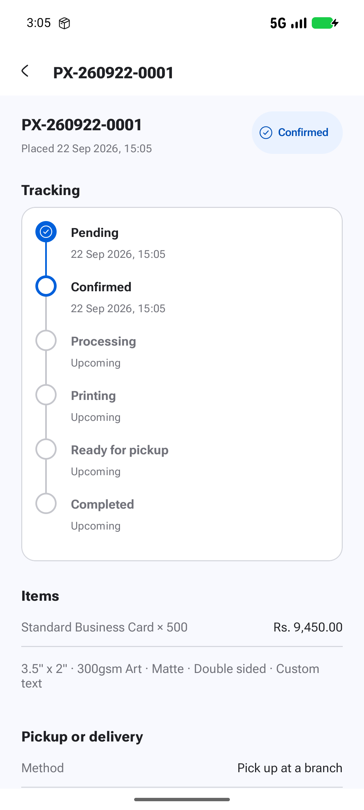 | **Order detail** shows a timeline with the time of each step, the items, pickup/delivery details and the price. It refreshes by itself when the status changes. |
| 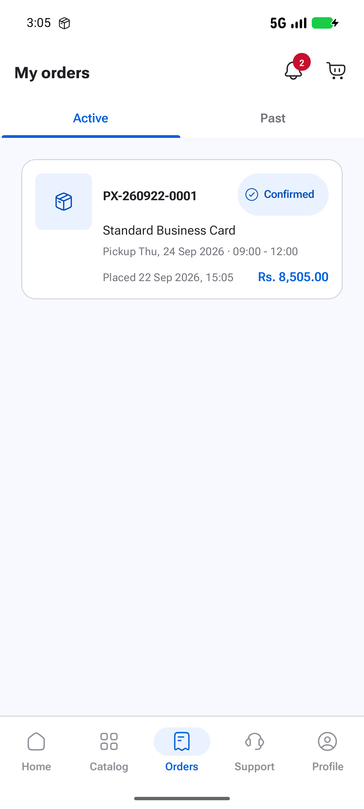 | **Orders** has *Active* and *Past* tabs. Pull down to refresh. |

| Status | Meaning |
|--------|---------|
| Pending | Order received |
| Confirmed | Accepted and queued for production |
| Processing | Artwork checked, print files prepared |
| Printing | On the press – **no more changes** |
| Ready for pickup / Out for delivery | Collect it at the branch / it is on the way |
| Completed | Collected or delivered |
| Cancelled | Cancelled by you before printing |

**Reschedule** and **Cancel** are only possible while an order is Pending, Confirmed or Processing.
- *Reschedule:* choose a new valid date and slot.
- *Cancel:* choose a reason, add a note if you like, and confirm.

Once printing starts, both buttons are disabled and a banner explains why. Finished orders show **Reorder**, which copies
the same items into your cart. **Need help with this order?** opens Contact support with the order already selected.

*Demo note:* the shop is simulated. With **Settings › Fast order simulation** on (the default), an order
moves one step every 20 seconds; with it off, every 10 minutes.

## 9. Notifications and offers

| | |
|---|---|
| 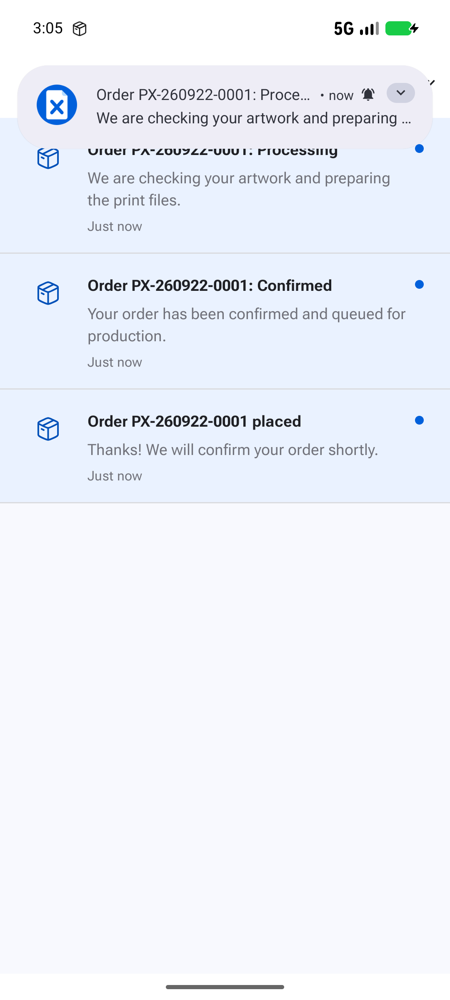 | **Notification centre** (bell icon): tap an entry to open its order or offer. Swipe to mark one read, or use **Mark all read**. A banner tells you if system notifications are turned off. |
| 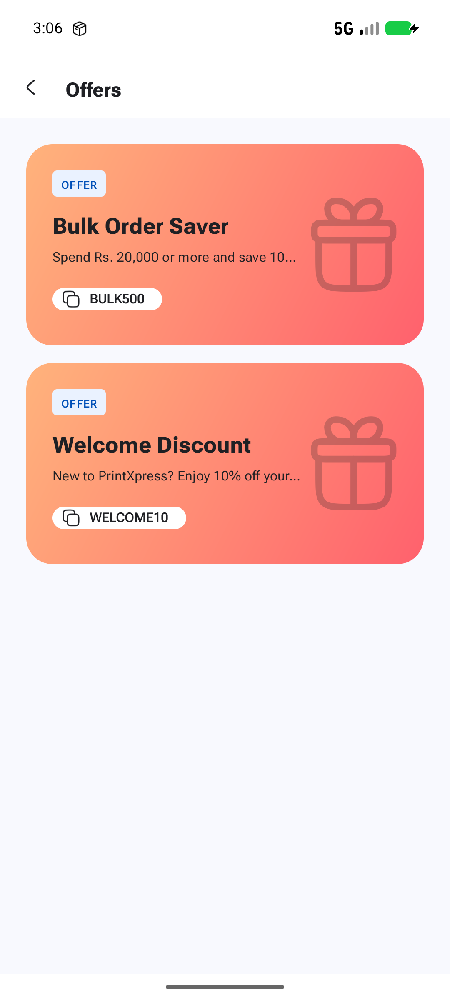 | **Offers** (Support › Offers and packages): tap a card for its terms (discount, validity, minimum, products), **Copy code**, or **Shop now**. |

Choose which notifications you receive under **Profile › Settings**: *Order updates* and *Offers and promotions*.

## 10. Profile

| | |
|---|---|
| 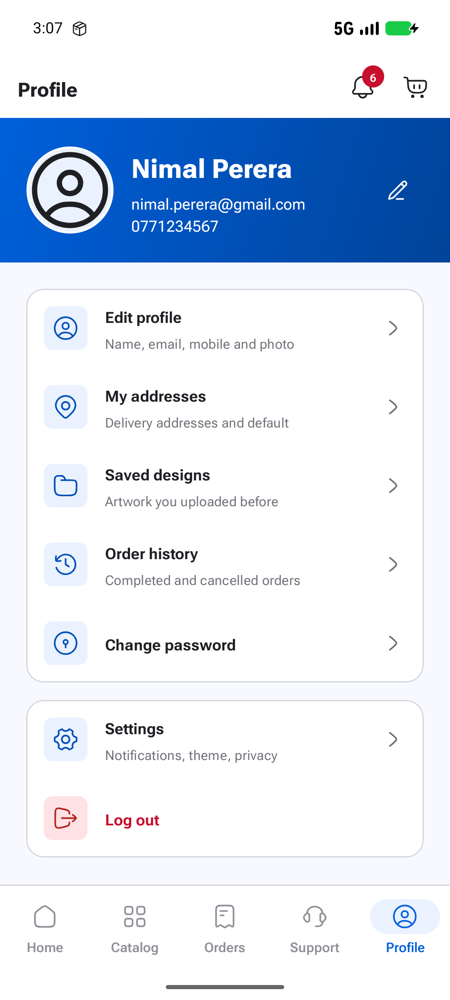 | Edit your name, email, phone and photo. Manage delivery **Addresses** (one default). Reuse or delete **Saved designs**. See **Order history**, **Change password** and **Log out**. |
| 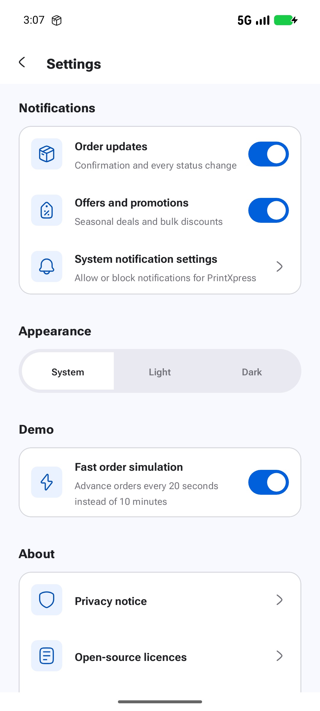 | **Settings:** notification preferences, a link to Android's notification settings, theme (System, Light or Dark), fast order simulation, the privacy notice, open-source licences and **Delete account**. |

**Delete account** permanently removes your profile, addresses, designs, cart, orders, tickets and
notifications from the device after you confirm.

## 11. Getting help

| | | |
|---|---|---|
| 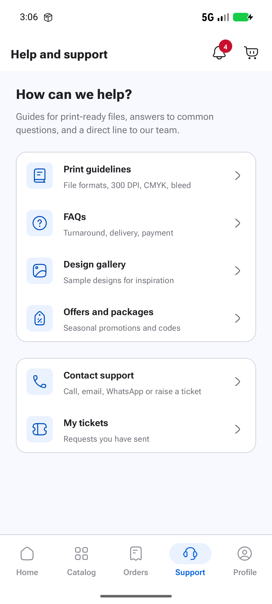 | 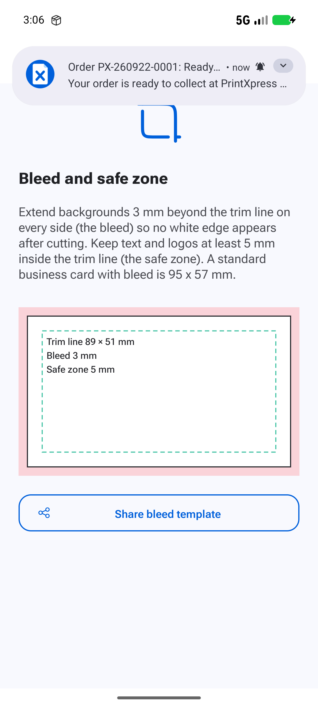 | 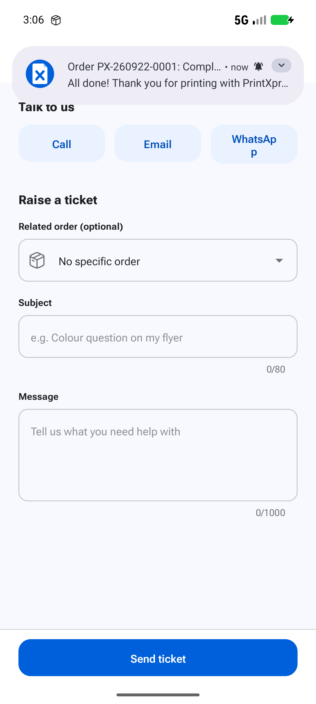 |

- **Print guidelines:** file formats, resolution, colour, bleed and fonts. The bleed page has a shareable template.
- **FAQs:** type to search questions and answers, then tap a question to expand it.
- **Design gallery:** sample designs by category. Tap one for a full-screen view; pinch or double-tap to zoom and swipe for the next.
- **Contact support:**
  - Call, email or WhatsApp in one tap.
  - Or raise a ticket: optional related order, subject of 5–80 characters and message of 10–1000 characters.
  - **My tickets** lists your requests and their status.

## 12. Troubleshooting

| Problem | Solution |
|---------|----------|
| "Unsupported file type" / "File is larger than 25 MB" | Export as PDF, PNG or JPG and reduce the size (flatten layers, 300 DPI is enough). |
| A date cannot be selected | It is before the earliest date for this product's turnaround, a Sunday or a public holiday. Choose the next open day. |
| No notifications appear | Allow notifications in **Settings › System notification settings** and check both switches in the app's Settings. The in-app centre still records every update. |
| Cannot cancel or reschedule | The order has reached *Printing* or later. Use **Need help with this order?** to contact the shop. |
| Promo code rejected | The message explains why: unknown, expired, below the minimum order, not valid for these products, or first order only. |
| "Invalid credentials" | Check the email or mobile number and password; use **Forgot password?** if needed. |

## 13. Privacy

- Everything you enter stays in the app's private storage on this device. No server receives it.
- Passwords are stored as salted PBKDF2 hashes, never as readable text.
- Uploaded files are copied into private storage, and the app never needs storage permission.
- The only permission requested is notifications, and it is optional.
- **Settings › Delete account** removes all of your data. Uninstalling the app also removes it.
